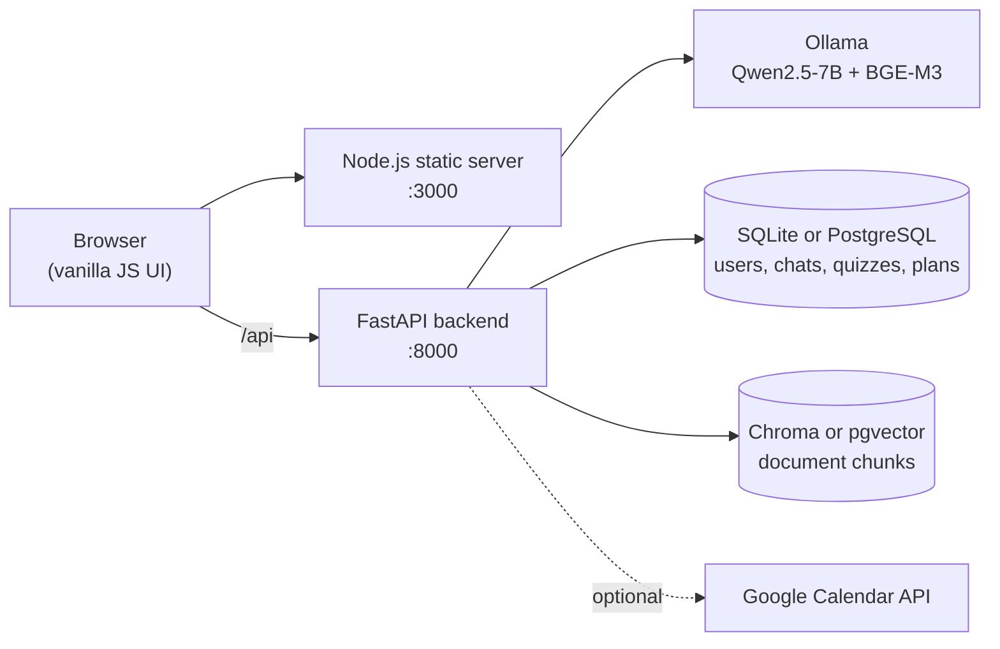

# AI Tutor

AI Tutor is a self-hosted study assistant that turns a learner's own course materials into a grounded
tutor and a personalized study plan. Learners upload PDF or TXT files, ask questions answered only
from those files (with citations), study with generated summaries, flashcards and quizzes, and follow
a schedule that adapts to their deadlines, availability and quiz results.

The language, embedding and vision models are open models served by [Ollama](https://ollama.com),
locally or on a Kaggle GPU. No cloud AI API is required.

## Key features

### RAG chatbot

- Answers are based on passages retrieved from the selected documents, with document and page
  citations.
- Each chat is scoped to its own set of sources, and conversations are saved per user.
- Answers stream in as they are generated, and follow-up questions use the recent conversation.
- When no relevant passage is found, the tutor reports insufficient context instead of answering.

### Personalized study planner

- Study plans built from the learner's materials, deadlines and goals.
- A schedule generated from weekly availability, a daily study target and session lengths, with
  three strategies: balanced, finish early, or deadline priority.
- A preview of the proposed schedule before it is confirmed.
- Sessions can be started, completed step by step, skipped or rescheduled.
- The plan adapts after a quiz, a missed session or a deadline change. For example, a low score
  leads to a weak-topic review and a quiz retry. The learner previews the proposed changes before
  applying them.
- Optional Google Calendar sync avoids busy times and adds study sessions as calendar events.

### Study tools

- **Document processing:** PDF and TXT uploads are chunked and embedded, and the topics of each
  document are detected. Scanned pages are read with OCR. A vision model can optionally describe
  figures when a GPU is available.
- **Summaries:** topic-by-topic document summaries, generated as background jobs.
- **Flashcards:** generated from the document, with practice quizzes built from the cards (short
  answer, fill in the blank, matching).
- **Quizzes:** built from a document and its flashcards. The model writes multiple choice
  questions, and the flashcards add word-bank fill-in-the-blank and matching activities. Quizzes
  have three difficulty levels, an automatic size or a custom 5–40 questions, and an explanation
  for any question on request.
- **Progress:** topic mastery from quiz results, per-document progress, and a "next up" view on
  the home page.
- **Accounts and subjects:** each user's data is private, and documents can be grouped into subjects.

## Tech stack

| Layer | Technology |
| --- | --- |
| Backend | Python, FastAPI, Uvicorn, LangChain |
| Frontend | HTML, CSS, vanilla JavaScript (no framework or bundler), served by a small Node.js server |
| LLM runtime | Ollama, default chat model Qwen2.5-7B-Instruct (Q4_K_M), embeddings BGE-M3 |
| Vector store | ChromaDB (local), or pgvector on PostgreSQL |
| Database | SQLite (default), or PostgreSQL/Supabase in durable mode |
| Document processing | pypdf, pypdfium2, RapidOCR |
| Deployment | Kaggle notebook, nginx, Cloudflare Worker and Quick Tunnel |

## Architecture



The backend is organized by feature. `backend/api/` holds the HTTP routers, `*_service.py` files
hold the business logic (RAG chat, ingestion, summaries, flashcards, quizzes, mastery, planner), and
`*_store.py` files handle persistence. Setting `DATABASE_URL` switches storage from local
SQLite/Chroma to PostgreSQL with pgvector and private Supabase Storage.

More detail is available in [docs/system-architecture](docs/system-architecture/README.md) and
[docs/ARCHITECTURE.md](docs/ARCHITECTURE.md) (in Vietnamese).

## Getting started (local)

### Prerequisites

- Python 3.10+ (developed and tested on 3.13)
- Node.js (only used to serve the frontend; there are no npm dependencies)
- [Ollama](https://ollama.com), running locally

### 1. Install

```powershell
python -m venv .venv
.\.venv\Scripts\Activate.ps1      # macOS/Linux: source .venv/bin/activate
pip install -r requirements.txt
```

### 2. Pull the models

```powershell
ollama pull bge-m3
ollama pull "hf.co/bartowski/Qwen2.5-7B-Instruct-GGUF:Q4_K_M"
```

### 3. Configure (optional)

Settings live in `config.py` and can be overridden with environment variables or a git-ignored
`.env.local` file in the project root. Real environment variables take precedence.

```powershell
Copy-Item .env.example .env.local
```

| Variable | Purpose |
| --- | --- |
| `OLLAMA_CHAT_MODEL` | Chat and generation model (default `hf.co/bartowski/Qwen2.5-7B-Instruct-GGUF:Q4_K_M`) |
| `OLLAMA_EMBEDDING_MODEL` | Embedding model (default `bge-m3`). Re-index documents after changing it. |
| `GOOGLE_CLIENT_ID`, `GOOGLE_CLIENT_SECRET`, `GOOGLE_CALENDAR_REDIRECT_URI`, `GOOGLE_CALENDAR_TOKEN_ENCRYPTION_KEY` | Optional Google Calendar integration |
| `DATABASE_URL`, `SUPABASE_URL`, `SUPABASE_SERVICE_ROLE_KEY` | Optional durable mode (PostgreSQL + pgvector + Supabase Storage) |
| `AI_TUTOR_VISION` | Vision descriptions of PDF figures: `auto` (only with a GPU), `on` or `off` |

Without any configuration, the app uses SQLite (`data/`) and Chroma (`vectorstore/`) on the
local disk.

### 4. Run

Start Ollama if it is not already running (`ollama serve`), then start the backend from the
project root:

```powershell
.\.venv\Scripts\python.exe -m uvicorn backend.main:app --reload --host 127.0.0.1 --port 8000
```

In a second terminal, start the frontend:

```powershell
cd frontend
npm start
```

Open http://localhost:3000 and create an account. The API documentation is at
http://127.0.0.1:8000/docs.

### Run the tests

```powershell
pip install pytest
.\.venv\Scripts\python.exe -m pytest tests
```

Some frontend tests run JavaScript with Node.js. Tests use temporary data directories and never
read `.env.local`.

## Kaggle deployment

The full stack (Ollama on a GPU, backend, frontend and nginx) can run inside a Kaggle notebook
behind a permanent Cloudflare Worker URL. App data is saved as snapshots to a private Kaggle
Dataset. See [KAGGLE_DEPLOYMENT.md](KAGGLE_DEPLOYMENT.md) (in Vietnamese) for setup, secrets and
troubleshooting.

## Project structure

```text
backend/
  api/                  HTTP routers per feature (auth, documents, chat, quiz, planner, ...)
  *_service.py          Business logic (RAG, ingestion, summaries, flashcards, quizzes, planner)
  *_store.py            Persistence (SQLite or PostgreSQL through db.py)
  main.py               FastAPI application
frontend/
  index.html, styles.css, app.js
  js/                   Feature scripts (chat, quiz, planner, session, ...)
  server.js             Static file server
prompts/                LLM prompts by feature (chat, quiz, summary, flashcards, topics, vision)
deployment/             Kaggle startup, nginx and persistence scripts
docs/                   Architecture and flow diagrams
tests/                  pytest suite
config.py               Paths, models and settings
kaggle_run_ollama_cloudflare.ipynb   Kaggle notebook (current)
```

## Troubleshooting

- **The backend cannot reach a model:** run `ollama list` and check that the model names match
  `OLLAMA_CHAT_MODEL` and `OLLAMA_EMBEDDING_MODEL`.
- **Chat answers that there is not enough context:** open **Sources** in the chat and select at
  least one indexed document.
- **Retrieval is wrong after changing the embedding model:** rebuild `vectorstore/` and index the
  documents again with the new model.
- **The UI looks outdated:** hard-reload the browser (`Ctrl + F5`).
